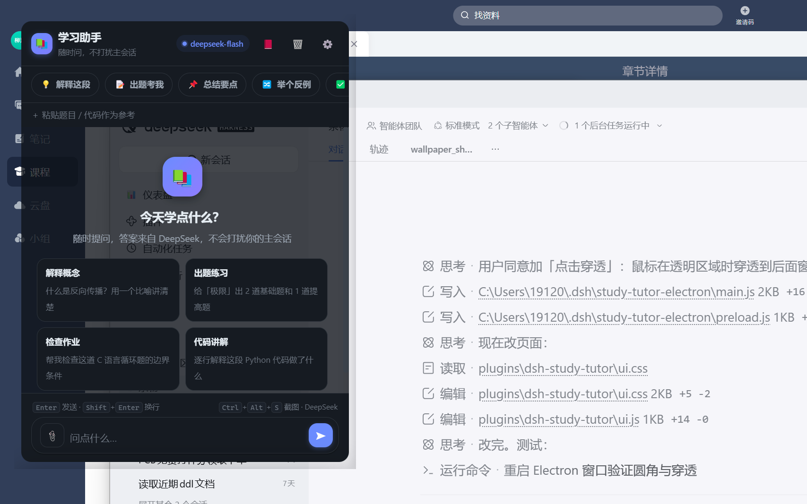
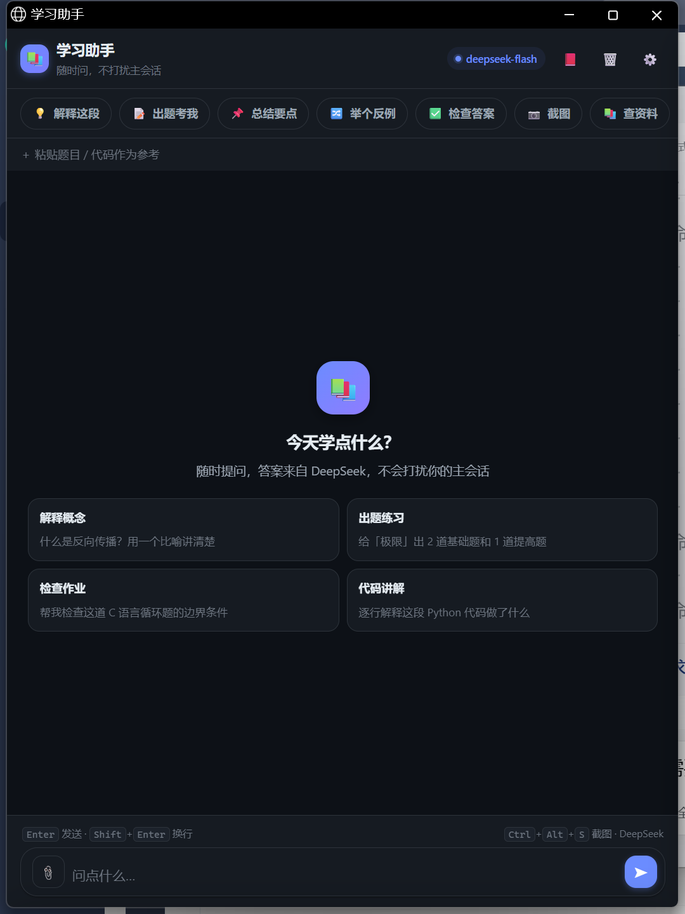

# dsh-study-tutor — 学习助手浮窗

> 在独立置顶的透明小窗里随时提问，走 DSH 的 `ctx.llm`（DeepSeek V4.1-Flash），**不占用、不打扰主会话**。



## 功能

- **独立置顶浮窗**：Electron 无边框透明窗口，背景透明、文字不透明，可拖拽移动/缩放/记忆位置
- **点击穿透**：窗口边缘 24px 透明区域可直接点到后面的窗口
- **LLM 流式对话**：Markdown 渲染、代码块语法高亮（Python/C/C++/JS/TS/Java/SQL/JSON/Bash）+ 行号 + 一键复制
- **截图提问**：`Ctrl+Alt+S` 或 📷 按钮，调用 Windows 系统截图（区域选择），图片作为附件提问
- **图片附件**：📎 按钮 / 粘贴 / 拖拽，最多 4 张（8MB/张）
- **查资料**：📚 开关接入 dsh-library 知识库检索（课程资料），回答可带引用
- **错题本**：对话中「加入错题本」，本地保存、可回顾复习
- **快捷键**：`Enter` 发送、`Shift+Enter` 换行、`Ctrl+K` 新对话、`Ctrl+L` 错题本、`Ctrl+,` 设置、`Ctrl+/` 聚焦输入框、`Alt+1..5` 预设提问、`Esc` 停止生成
- **设置**：主题（跟随系统/亮/暗）、字号、紧凑模式、发送方式、窗口尺寸（小/中/大）
- **`/study` 命令**：在主会话里输入 `/study` 直接打开学习助手窗口



## 安装

```bash
# 1. 放到插件目录
git clone https://github.com/lyy40404/dsh-study-tutor.git
# 或直接引用本地目录

# 2. 安装到 DSH profile（按你的 profile 名调整）
dsh plugin --profile desktop add <本仓库路径>

# 3. 重启 DSH 生效
```

### 依赖（Windows）

| 依赖 | 用途 | 安装 |
|---|---|---|
| Python 3.8+ | 窗口透明度 / 系统截图 / 知识库检索脚本 | `winget install Python.Python.3` |
| Pillow | 截图与图片读取 | `pip install pillow` |
| Electron 33+ | 透明窗口运行时 | 见下方 `~/.dsh/study-tutor-electron`（`main.js` + `preload.js` 随仓库附带参考） |
| PowerShell 5.1+ | 窗口启动器 | 系统自带 |

> 没有 Electron 时自动回退到 Edge/Chrome 的 `--app` 模式（整窗透明，不支持只透背景）。

## 使用

- **打开窗口**：桌面快捷方式 / `/study` 命令 / DSH 插件入口
- **快捷键**：见上表（窗口内生效）
- **截图**：`Ctrl+Alt+S` 触发系统截图工具，框选后自动作为图片附件
- **查资料**：打开 📚 开关后提问，会先检索本地知识库再回答

## 结构

```
index.js              装配入口：路由注册 + /study 命令
lib/
  config.js           路径常量（插件目录、DSH_HOME、Python 脚本路径）
  util.js             HTTP 读写、Python 定位
  window.js           窗口透明度、启动独立窗口
  screenshot.js       系统级区域截图（子进程）
  search.js           知识库检索（子进程）
  ask.js              LLM 流式问答（ctx.llm.stream + 图片附件）
  commands.js         /study 斜杠命令
ui.html / ui.css / ui.js   前端界面（聊天、附件、设置、错题本）
*.py                  窗口透明度 / 截图 / 检索脚本
open-study-tutor.ps1  窗口启动器（Electron 优先，Edge 回退）
```

## 工作原理

```
Electron 透明窗口（480×640）
   │  http://127.0.0.1:<DSH端口>/study-tutor/*
   ▼
host 插件（本仓库 index.js）
   ├─ webServer 路由：/study-tutor/{ui,ui.css,ui.js,models,ask,search,screenshot,open,window}
   ├─ ctx.llm.stream：流式问答（SSE 回传）
   ├─ ctx.attachments.admitPromptContent：图片附件
   └─ 子进程：Python 脚本（透明度/截图/检索）
```

## 配置

- 窗口透明度/位置：`~/.dsh/study-tutor-window.json`
- 模型：默认 `deepseek-official` / `deepseek-flash`（可在设置里切换）
- 知识库：使用 `dsh-library` 插件（本插件通过 `search_library.py` 检索）

## 已知限制

- Windows 平台（Win32 API 依赖 Python ctypes）
- Edge/Chrome 回退模式不支持「背景透明 + 文字不透明」（Chromium 限制，需 Electron）
- 截图依赖 Windows 系统截图（`ms-screenclip:`），部分安全软件可能拦截

## License

MIT
